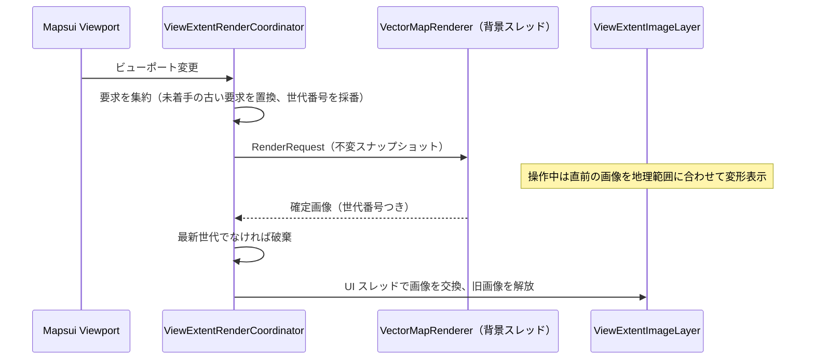

# 設計: ベクター地図レンダラーの統合

- 状態: 設計（PoC 未着手）
- 追跡 Issue: #293（PoC）、#295（製品統合）、#297（航空写真＋道路オーバーレイ）／親: #290
- 概要・依存関係: [README.md](README.md)
- 参照: photo-map-studio `docs/development/vector-map-architecture.md`、Google ドキュメント『PhotoMapStudio / PhotoGeoExplorer ベクター地図レンダラー拡張アイデア・ロードマップ』（コード照合日 2026-10-24）

## 1. 目的と成功条件

PhotoMapStudio の SkiaSharp ベクター描画エンジンを、地図ペインの背景として使えるようにする。第一の目標は、**見た目・操作方法・応答性を保ったまま、スタイル・レイヤー合成・道路形状の利用を拡張しやすくすること**である。生活道路名の優先表示（撮影地点が「どの道路沿いか」を一目で分かる地図）は、その拡張性の上で実現する成果と位置づける。

**成功条件は「利用者が変化にほぼ気づかない」こと**である。パン・ズームの追従、写真選択時の地図移動、初回表示、再訪時の表示が現行から退行しないことを、採用の前提にする。自由度が上がることだけを理由に、退行を受け入れない。

比較の基準は 2 つあり、混同しない。

| 観点 | 基準 |
|---|---|
| 見た目・性能 | 現行の PhotoGeoExplorer |
| 道路表現・ラベル処理の実装品質 | PhotoMapStudio |

PhotoMapStudio の静止画向けの計測値（1 枚あたりの描画時間など）は、対話操作での達成値として流用しない。

## 2. 現状と再利用する資産

### PhotoGeoExplorer 側の接続点

- `MapPaneService` が背景の `TileLayer` を作り、`MapPaneViewModel` が背景の切り替え（`SwitchTileSource`）と写真マーカーの `MemoryLayer` を管理する。
- `MapsuiMapImageRenderer` が `MapRenderer.RenderToBitmapStream` で PNG を保存する。
- `IMapPaneService.InitializeMap` / `CreateTileLayer` の戻り値は `TileLayer` 型で固定されている。

### PhotoMapStudio 側の資産（`PhotoMapStudio.Core/Tiles/Vector`）

| 資産 | 役割 | SkiaSharp 依存 |
|---|---|---|
| `IVectorTileSource`、`OpenFreeMapTileSource`、`GsiVectorTileSource`、`Pmtiles/*`、`CachedVectorTileSource` | MVT の取得とディスクキャッシュ | なし |
| `VectorTileDecoder`、`VectorTileModel` | MVT のデコード | なし |
| `IVectorMapStyle`、`OpenMapTilesStyle`、`GsiVectorStyle`、`OpenMapTilesRoadSymbols` | スキーマ解釈とスタイル | あり |
| `VectorMapRenderer`、`LabelCollisionGrid`、`PathLabelRenderer` | 表示範囲全体への描画、ラベルの衝突判定、道路沿いラベル | あり |

### そのままでは足りない点

- `IVectorMapRenderer.RenderToCanvasAsync` は**整数ズーム**（`int zoom`）と中心座標・幅・高さを取る。Mapsui は連続的な解像度（m/px）で表示するため、取得ズーム（整数）と表示倍率（連続）を分けた入口が要る。
- 静止画の一括生成向けの設計で、描画の途中キャンセル、デコード済みモデルのキャッシュ、DPI の指定がない。
- 道路名を地名・施設名より優先し POI を間引く、PhotoGeoExplorer 向けのスタイル調整がない。

## 3. アーキテクチャ: 表示範囲単位の非同期描画

256×256 のタイル画像に分割して描くと、ラベルがタイル境界で切れる。これを避けるため、**表示範囲全体を 1 枚の画像として背景スレッドで描き、操作中は直前の画像を地理座標に合わせて変形表示する**。



### 3.1 描画要求（`VectorRenderRequest`）

不変のレコードとして、次を持つ。

- 中心座標、表示解像度（m/px）、画面サイズ（論理ピクセル）、DPI 倍率
- ソース（OpenFreeMap／地理院）とスタイルの版
- 世代番号

取得ズームは解像度から決める整数、表示倍率は連続値として分ける。操作後は表示倍率と物理ピクセル寸法に合わせて描き直すため、ベクターの過拡大でも線と文字が鮮明になる。

### 3.2 実行制御（`ViewExtentRenderCoordinator`）

- 同時に走る描画は 1 つ。待ち行列は持たず、**未着手の要求は最新の 1 件で置き換える**。
- **実行中の描画は、原則として最後まで走らせる。** 新しい要求のたびにキャンセルすると、連続したパン・ズームの間は確定描画が一度も完了せず、直前画像が表示範囲から外れて背景が白紙になる。完了した画像は最新の要求とは少しずれるが、地理範囲に合わせて配置するので位置は正しく、直前画像として使える。
- 実行中の描画をキャンセルするのは、結果が使えないと分かっている場合だけにする: ソース・スタイルの切り替え、レイヤーの破棄、実行中の描画範囲が現在の表示範囲と重ならなくなった場合、取得ズームが変わった場合。描画の主要ループ（レイヤー・フィーチャー単位）でキャンセルを確認する。
- この方針（完走させる／キャンセルする条件）は P2 で連続操作の計測をして確定する。
- 完了した画像は世代番号を照合し、最新でなければ破棄する（古い画像への巻き戻りを防ぐ）。
- 画像の交換は `IUiDispatcher` で UI スレッドへ移す。
- **画像の所有権**: `SKImage` は参照カウントつきのホルダーで持つ。描画する側（Mapsui のスタイルレンダラー、PNG 保存）は描画の間だけ参照を取得し、終わったら返す。交換で外れた画像は、参照がすべて返ってから `Dispose` する。Mapsui の描画が UI スレッド以外で走る構成でも、解放済みの画像を描かないようにするため。交換の直後に無条件で `Dispose` しない。
- このクラスは Mapsui にも WinUI にも依存させず、単体テストで順序・キャンセル・世代を検証できるようにする。

### 3.3 Mapsui への注入（`ViewExtentImageLayer`）

- 第 1 候補: 専用レイヤー（1 フィーチャー＝「画像＋その地理範囲」）と、カスタムスタイルレンダラーで `SKImage` を地理範囲の画面矩形へ描く。エンコードを挟まず、Mapsui がビューポート変換を行うので、操作中の「直前画像の追従」がレイヤーの通常描画として成立する。`RenderToBitmapStream`（PNG 保存）にも同じ経路で乗る。
- 比較案: Mapsui の `RasterFeature`（エンコード済み画像＋範囲）。実装は少ないが、交換のたびに PNG エンコード・デコードが入る。
- PoC P1 で両方を実装して確定描画から表示までの時間を測り、第 1 候補が Mapsui 5.1 の公開 API で成立しない、または差が無視できる場合は比較案を採る。
- 写真マーカーの `MemoryLayer` は現行のまま上に重ねる（ピンは Mapsui が描くので、位置の一致は範囲の正しさだけで決まる）。

### 3.4 キャッシュ

| 層 | 内容 | 鍵 | 方針 |
|---|---|---|---|
| MVT バイト列 | 取得したタイル | ソース識別子・版・z/x/y | PhotoMapStudio のディスクキャッシュ（保持期間・容量上限・LRU）をそのまま使う |
| デコード済みモデル | `VectorTileModel` | 上に同じ | メモリ上の容量制限つき LRU（新設） |
| 表示用画像 | 確定画像 | 範囲・倍率・DPI・スタイル版 | 直前の 1 枚だけ保持（タイル単位の画像キャッシュは持たない） |

### 3.5 ラベルの安定性

現行の `VectorMapRenderer` は、描画のたびに衝突判定を作り直す。対話操作では、パンのたびにラベルの位置が飛ぶ、表示が出入りする、という見え方になりうる。PoC で録画して観察し、問題になる場合だけ配置の継続性（前回の配置を優先する等）を改善する。

余白つきの描画（表示範囲より広く描いて、パン時の再描画を減らす）は、描画範囲とメモリへの効果を測ってから採否を決める。

### 3.6 先行取得

第 1 段階では表示範囲に必要なタイルだけを取得する。外周の先行取得は、応答性の計測（P2）で必要と分かった場合の第 2 段階とし、配信元の取得制限・並列数・キャンセルを守る。

### 3.7 PNG 保存

保存時のビューポートと `pixelDensity` で確定描画を 1 回行い、**保存専用のレイヤー**に入れて `RenderToBitmapStream` へ渡す。操作中の変形表示（低解像度）のまま保存しない。

- 表示中のレイヤーには触らない。保存用の画像を表示中のレイヤーへ設定すると、画面が一瞬ずれた表示になり、コーディネーターの交換・解放と競合する。
- `MapsuiMapImageRenderer` は現在 `map.Layers` をそのまま描いている。これを「保存用の背景レイヤー（`IMapBackground.CreateExportLayersAsync` の戻り値）＋写真マーカーのレイヤー」のリストを受け取る形に変える。ラスタの背景は表示中のレイヤーをそのまま返す。
- 保存用のレイヤーと画像は、保存が終わったら破棄する。
- 背景とピンは同じビューポートのスナップショットから描くので、古い背景と新しいピンが混在しない。

### 3.8 型契約の整理

`IMapPaneService` の `TileLayer` 固定を外し、背景を次の抽象で扱う。

```csharp
internal interface IMapBackground : IDisposable
{
    IReadOnlyList<ILayer> Layers { get; }   // 下から順。ラスタ・ベクター単体は 1 要素
    string AttributionText { get; }

    // PNG 保存用。ラスタは Layers をそのまま返す。ベクターは保存用に確定描画した別レイヤーを返す。
    Task<IMapExportLayers> CreateExportLayersAsync(Viewport viewport, float pixelDensity, CancellationToken ct);
}
```

レイヤーは最初から複数を前提にする。航空写真＋道路オーバーレイ（§9）は 2 層になるため、単一レイヤーの契約で始めると `MapPaneViewModel`・PNG 保存・破棄処理を後で作り直すことになる。

この整理は [01](01-mapbox-satellite.md) の `MapBackgroundRequest` と合わせて行い、`MapPaneViewModel` はラスタ／ベクターの違いを知らない状態にする。

## 4. スタイル方針

- **初期導入は、現行に近い見た目を基準にする。** 名称の密度や優先順位を大きく変える表現は、別のスタイルプロファイル（後続の変更）として評価する。エンジンの置換とスタイルの変更を同時に行わない。
- 現行のラスタ（OSM Carto）と MVT（OpenMapTiles）では配信される内容が違う。見た目の差を評価するときは、**配信データの違いによる差**と**描画エンジンの違いによる差**を分ける。
- 配置の優先順は、経路番号の盾（高速・国道・都道府県道）→ 道路名 → 地名・施設名。PhotoMapStudio の順序と衝突回避を維持する。
- 道路名優先のプロファイル（後続）: 生活道路（`minor`・`service`）の名称を低いズームから出し、POI の密度を下げる。表示できる名称は取得元のデータに依存する。取得元の最大ズームを超えて拡大しても、情報量は増えない。
- スタイルの差分は `OpenMapTilesStyle` のオプション（プロファイル）として持たせ、PhotoMapStudio の既定の見た目は変えない。
- PoC では、既存のスタイルを保ったまま道路名の優先順位またはレイヤー構成を変える小さな実証を行い、拡張性が実際に上がることを確認する。

## 5. 実装の共有方法

- **PoC（#293）**: スパイクブランチで PhotoMapStudio の `Tiles/Vector` を一時的に取り込む。このブランチは `main` へマージしない。手順書・基準値・計測結果などの成果物（`docs/Architecture/MapEnhancement/poc/`）は、取り込んだコードを含まない別ブランチの PR で `main` へ入れる。
- **製品統合（#295）**: PhotoMapStudio 側でライブラリを切り出して NuGet パッケージにし、PhotoGeoExplorer は `PackageReference` で使う。共有の形は操作 PoC が成立してから確定する（PoC の前に抽出作業を始めない）。
  - 取得・デコード層（SkiaSharp 非依存）と描画層（SkiaSharp 依存）を別パッケージにする。最寄り道路名（[03](03-location-info.md)）は前者だけで足りる。
  - コピーでの二重保守、サブモジュール（Core 全体と不要な依存を引き込む）は採らない。
  - **取得・デコード層のパッケージ化は、描画の採否と独立に進める。** #296（最寄り道路名）の着手時に photo-map-studio へ起票する。#293 が「不採用」でも行う。
  - 描画層のパッケージ化は、#293 の採否が「採用」になった時点で photo-map-studio に起票する。

## 6. 依存関係の方針

- SkiaSharp を継続利用する。PhotoGeoExplorer は Mapsui.Rendering.Skia と PNG 保存で既に Skia に依存しており、ImageSharp.Drawing へ移してもネイティブ依存はなくならない。
- **SkiaSharp の版**: PhotoMapStudio は 4.x、Mapsui 5.1.0 は自身の依存する版を持つ。同一プロセスでは 1 つの版に統一されるので、P1 の最初に「解決後の版で Mapsui の描画と PNG 保存が動くこと」を確認する。動かない場合はダウングレードせず、Mapsui の対応版を待つ（PoC は保留）。

## 7. PoC 計画（#293）

PoC の主題は、**見た目と操作性能をほぼ変えずに、描画内部の自由度・拡張性を高められるか**である。最初に、Mapsui 上で表示範囲画像を地理的に正しく配置できるかを確認する。

### 7.1 段階

| 段階 | 内容 | 完了の判定 |
|---|---|---|
| P0 比較基準の固定 | 現行版と PoC のコミット、端末、画面範囲・寸法、DPI、写真選択、パン・ズームの操作手順、キャッシュ条件を固定し、基準画像・操作録画・性能値を採取する。PhotoMapStudio の保存 MVT と基準画像、利用するコミットも固定する | 手順書と基準値が `docs/Architecture/MapEnhancement/poc/` にあり、**許容差が決まっている** |
| P1 オフライン操作 | 保存済み MVT で、Mapsui の中心・解像度に合わせた表示範囲画像を描いて配置する。SkiaSharp の版整合、注入方式の比較もここで行う | パン・連続ズーム・リサイズ・DPI 切り替え・複数ピンで、ピンと背景の位置が一致する |
| P2 応答性 | 背景スレッド描画、要求の集約、世代管理、デコード済みキャッシュを足す | 高速な連続操作、描画中のソース切り替え、画面終了で、古い結果が反映されない |
| P3 通信と既存機能 | 実タイルの取得、失敗・欠落・キャンセル、OSM／航空写真への切り替え、PNG 保存 | 保存した PNG に背景・ピン・出典が含まれ、古い背景と新しいピンが混在しない |

**PoC に含めないもの**: ImageSharp への移植、航空写真への道路の重ね合わせ、最寄り道路の検索、すべての取得元への対応。初期は OpenMapTiles 系の保存データで進め、成立後に地理院 PMTiles などを足す。

### 7.2 計測条件

- 記録するもの: Windows・CPU・GPU・アーキテクチャ、DPI、物理描画寸法、データ範囲、ソースのコミット、キャッシュの状態
- 対象の場所: 住宅地と郊外の境界、密集市街地、タイル境界
- 寸法と DPI: 800×600 と実際のペイン寸法、100%・150%・200%
- ズーム: z15〜19 と連続倍率
- 現行版と PoC を同じ条件で複数回測り、通常の測定ばらつきを見たうえで差分を評価する
- 現行のラスタと MVT で配信内容が違うため、**描画だけの比較**と**通信を含む比較**を分ける

### 7.3 採否の判断基準

**基準は現行版との差分である。** 下の数値は補助的な暫定目標で、現行より遅くなることを許す根拠にしない。許容差は、P0 の基準計測のあと、採否を判定する前に決める。

| 項目 | 基準 |
|---|---|
| 入力追従 | フレーム時間の p50／p95、長い停止、入力から画面反映までの遅延を現行と比較する。60fps 相当（約 16.7ms/フレーム）は補助目標。**目標値以内でも、現行より体感できる退行があれば不合格** |
| 確定描画 | 初回表示・ウォーム時・再訪時・操作停止後に鮮明な画像が出るまでの時間を、p50／p95 で現行と比較する。ウォーム時 p95 200ms 以下は補助目標（現行がより速い場合に 200ms まで遅くなってよい、という意味ではない）。通信待ちと描画時間を分ける。**直前画像の追従表示だけで合格にしない** |
| 処理内訳 | 取得、デコード、線・面の描画、ラベル配置、画像の転送・反映を別々に測る。要求数、破棄した旧要求、キャッシュ命中率、CPU、ピーク・定常メモリ、ネイティブ画像の解放を記録する |
| 他機能への影響 | 背景スレッドの描画が、写真一覧・サムネイル・プレビューを遅くしない |
| 正しさ | ピン位置のずれ、古い結果への巻き戻り、意図しない白紙化、繰り返し操作でのメモリの単調増加がない。PNG 保存が正しい |
| 品質 | 現行に近い見た目。道路名の折れ線追従・境界付近の配置を基準画像と比較する。ラベルの出入り・位置飛びを録画で評価する |
| 拡張性 | 既存のスタイルを保ったまま、道路名の優先順位またはレイヤー構成を変える小さな実証ができる |

採用の条件は、現行に近い見た目、体感上の性能の非退行、位置の整合、PNG 保存を満たし、拡張性の実証ができること。遅い場合は計測に沿って改善する（デコードの再利用、要求の集約、配置処理など）。改善できなければ方式を見直す。ImageSharp への移植を、性能問題の自動的な解決策として扱わない。

### 7.4 成果物

- 再現できる操作 PoC
- 固定データによる基準画像と操作録画
- 性能・メモリの計測表
- Mapsui への接続方式と制約
- 次の実装単位の提案

結果は #293 に記録し、「採用／条件つき採用／不採用」を決める。不採用の場合、#295・#297 は閉じる。取得・デコード層の共有（道路名サジェスト用）は、描画の採否と切り離して進める（§5）。

## 8. 製品統合（#295）の範囲

- `MapTileSourceType` に `VectorOpenFreeMap`（必要なら `VectorGsi`）を追加し、設定の選択肢に出す。既定の背景は変えない。
- 初期のスタイルは現行に近い見た目にする。道路名優先のプロファイルは、エンジンの統合が済んでから、選べるスタイルとして別の PR で追加する（§4）。
- 描画・取得の失敗時の表示（部分的に取得できない、オフライン）。失敗を隠して別の背景へ自動で切り替えない。
- 帰属表示（OSM、OpenFreeMap、国土地理院）を画面と PNG に出す。
- ベクタータイルのキャッシュ設定（容量上限）を設定画面に出すかを決める。
- テスト: `ViewExtentRenderCoordinator` の順序・キャンセル・世代（パラメータ化）、E2E は背景切り替えとピン表示の非退行。

## 9. 将来拡張: 航空写真＋道路ベクターの透過オーバーレイ（#297）

航空写真（Esri／Mapbox）の上に、道路の芯線と道路名ラベル（白フチつき）だけを透過で重ねる表示モード。

- 背景を透過でクリアし、面ポリゴンを描かず、道路線とラベルだけを描くスタイルプロファイルを足す。
- 航空写真と同じビューポート・倍率・DPI で描き、PNG 保存でも両方を合成する。
- 構成は「ラスタの `TileLayer` ＋ `ViewExtentImageLayer`」の 2 層になる。§3.8 の `IMapBackground.Layers` に 2 要素を入れる。

## 10. リスク

| リスク | 対応 |
|---|---|
| SkiaSharp の版が Mapsui と合わない | P1 の最初に確認。合わなければ保留（ダウングレードしない） |
| カスタムレンダラーが Mapsui 5.1 の公開 API で書けない | `RasterFeature` 案へ切り替え、性能を再計測 |
| 大都市部・高ズームで確定描画が遅い | デコード済みキャッシュ、POI の間引き。基準を満たさなければ不採用 |
| OpenFreeMap の配信条件の変更 | 取得元は抽象化済み。PMTiles の BYO を選択肢に残す |
