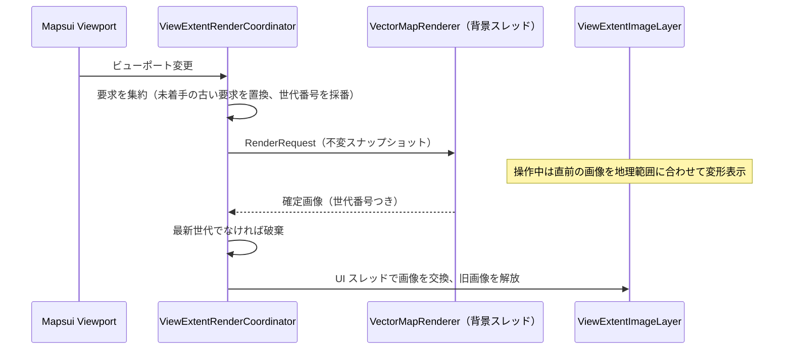

# 設計: ベクター地図レンダラーの統合

- 状態: 設計（PoC 未着手）
- 追跡 Issue: #293（PoC）、#295（製品統合）、#297（航空写真＋道路オーバーレイ）／親: #290
- 概要・依存関係: [README.md](README.md)
- 参照: photo-map-studio `docs/development/vector-map-architecture.md`

## 1. 目的と成功条件

PhotoMapStudio の SkiaSharp ベクター描画エンジンを、地図ペインの背景として使えるようにする。狙いは生活道路名の視認性で、撮影地点が「どの道路沿いか」を一目で分かるようにすること。

**成功条件は「利用者が変化にほぼ気づかない」こと**である。パン・ズームの追従、写真選択時の地図移動、初回表示、再訪時の表示が現行から退行しないことを、採用の前提にする。

## 2. 現状と再利用する資産

### PhotoGeoExplorer 側の接続点

- `MapPaneService` が背景の `TileLayer` を作り、`MapPaneViewModel` が背景の切り替え（`SwitchTileSource`）と写真マーカーの `MemoryLayer` を管理する。
- `MapsuiMapImageRenderer` が `MapRenderer.RenderToBitmapStream` で PNG を保存する。
- `IMapPaneService.InitializeMap` / `CreateTileLayer` の戻り値は `TileLayer` 型で固定されている。

### PhotoMapStudio 側の資産（`PhotoMapStudio.Core/Tiles/Vector`）

| 資産 | 役割 | SkiaSharp 依存 |
|---|---|---|
| `IVectorTileSource`、`OpenFreeMapTileSource`、`GsiVectorTileSource`、`Pmtiles/*`、`CachedVectorTileSource` | MVT の取得とディスクキャッシュ | なし |
| `VectorTileDecoder`、`VectorTileModel` | MVT のデコード | なし |
| `IVectorMapStyle`、`OpenMapTilesStyle`、`GsiVectorStyle`、`OpenMapTilesRoadSymbols` | スキーマ解釈とスタイル | あり |
| `VectorMapRenderer`、`LabelCollisionGrid`、`PathLabelRenderer` | 表示範囲全体への描画、ラベルの衝突判定、道路沿いラベル | あり |

### そのままでは足りない点

- `IVectorMapRenderer.RenderToCanvasAsync` は**整数ズーム**（`int zoom`）と中心座標・幅・高さを取る。Mapsui は連続的な解像度（m/px）で表示するため、取得ズーム（整数）と表示倍率（連続）を分けた入口が要る。
- 静止画の一括生成向けの設計で、描画の途中キャンセル、デコード済みモデルのキャッシュ、DPI の指定がない。
- 道路名を地名・施設名より優先し POI を間引く、PhotoGeoExplorer 向けのスタイル調整がない。

## 3. アーキテクチャ: 表示範囲単位の非同期描画

256×256 のタイル画像に分割して描くと、ラベルがタイル境界で切れる。これを避けるため、**表示範囲全体を 1 枚の画像として背景スレッドで描き、操作中は直前の画像を地理座標に合わせて変形表示する**。



### 3.1 描画要求（`VectorRenderRequest`）

不変のレコードとして、次を持つ。

- 中心座標、表示解像度（m/px）、画面サイズ（論理ピクセル）、DPI 倍率
- ソース（OpenFreeMap／地理院）とスタイルの版
- 世代番号

取得ズームは解像度から決める整数、表示倍率は連続値として分ける。操作後は表示倍率と物理ピクセル寸法に合わせて描き直すため、ベクターの過拡大でも線と文字が鮮明になる。

### 3.2 実行制御（`ViewExtentRenderCoordinator`）

- 同時に走る描画は 1 つ。待ち行列は持たず、**未着手の要求は最新の 1 件で置き換える**。
- 新しい要求が来たら実行中の描画をキャンセルする。描画の主要ループ（レイヤー・フィーチャー単位）でキャンセルを確認する。
- 完了した画像は世代番号を照合し、最新でなければ破棄する（古い画像への巻き戻りを防ぐ）。
- 画像の交換は `IUiDispatcher` で UI スレッドへ移す。交換で不要になった `SKImage` は直ちに `Dispose` する。
- このクラスは Mapsui にも WinUI にも依存させず、単体テストで順序・キャンセル・世代を検証できるようにする。

### 3.3 Mapsui への注入（`ViewExtentImageLayer`）

- 第 1 候補: 専用レイヤー（1 フィーチャー＝「画像＋その地理範囲」）と、カスタムスタイルレンダラーで `SKImage` を地理範囲の画面矩形へ描く。エンコードを挟まず、Mapsui がビューポート変換を行うので、操作中の「直前画像の追従」がレイヤーの通常描画として成立する。`RenderToBitmapStream`（PNG 保存）にも同じ経路で乗る。
- 比較案: Mapsui の `RasterFeature`（エンコード済み画像＋範囲）。実装は少ないが、交換のたびに PNG エンコード・デコードが入る。
- PoC P1 で両方を実装して確定描画から表示までの時間を測り、第 1 候補が Mapsui 5.1 の公開 API で成立しない、または差が無視できる場合は比較案を採る。
- 写真マーカーの `MemoryLayer` は現行のまま上に重ねる（ピンは Mapsui が描くので、位置の一致は範囲の正しさだけで決まる）。

### 3.4 キャッシュ

| 層 | 内容 | 鍵 | 方針 |
|---|---|---|---|
| MVT バイト列 | 取得したタイル | ソース識別子・版・z/x/y | PhotoMapStudio のディスクキャッシュ（保持期間・容量上限・LRU）をそのまま使う |
| デコード済みモデル | `VectorTileModel` | 上に同じ | メモリ上の容量制限つき LRU（新設） |
| 表示用画像 | 確定画像 | 範囲・倍率・DPI・スタイル版 | 直前の 1 枚だけ保持（タイル単位の画像キャッシュは持たない） |

### 3.5 先行取得

第 1 段階では表示範囲に必要なタイルだけを取得する。外周の先行取得は、応答性の計測（P2）で必要と分かった場合の第 2 段階とし、配信元の取得制限・並列数・キャンセルを守る。

### 3.6 PNG 保存

保存時のビューポートと `pixelDensity` で確定描画を 1 回行い、その画像をレイヤーに設定してから `RenderToBitmapStream` を呼ぶ。操作中の変形表示（低解像度）のまま保存しない。`IMapImageRenderer` の呼び出し側（`MapImageService`）に「背景の確定を待つ」段を足す。

### 3.7 型契約の整理

`IMapPaneService` の `TileLayer` 固定を外し、背景を次の抽象で扱う。

```csharp
internal interface IMapBackground : IDisposable
{
    ILayer Layer { get; }
    string AttributionText { get; }
    Task EnsureRenderedAsync(Viewport viewport, float pixelDensity, CancellationToken ct); // ラスタは即完了
}
```

この整理は [01](01-mapbox-satellite.md) の `MapBackgroundRequest` と合わせて行い、`MapPaneViewModel` はラスタ／ベクターの違いを知らない状態にする。

## 4. スタイル方針（道路名優先）

- 配置の優先順は、経路番号の盾（高速・国道・都道府県道）→ 道路名 → 地名・施設名。PhotoMapStudio の順序と衝突回避を維持する。
- 生活道路（`minor`・`service`）の名称を、一般的な地図より低いズームから出す。
- POI は密度を下げる（名称つきの主要なものに限る）。
- スタイルの差分は `OpenMapTilesStyle` のオプション（プロファイル）として持たせ、PhotoMapStudio の既定の見た目は変えない。

## 5. 実装の共有方法

- **PoC（#293）**: スパイクブランチで PhotoMapStudio の `Tiles/Vector` を一時的に取り込む。このブランチは `main` へマージしない。
- **製品統合（#295）**: PhotoMapStudio 側でライブラリを切り出して NuGet パッケージにし、PhotoGeoExplorer は `PackageReference` で使う。
  - 取得・デコード層（SkiaSharp 非依存）と描画層（SkiaSharp 依存）を別パッケージにする。最寄り道路名（[03](03-location-info.md)）は前者だけで足りる。
  - コピーでの二重保守、サブモジュール（Core 全体と不要な依存を引き込む）は採らない。
  - パッケージ化の Issue は、#293 の採否が「採用」になった時点で photo-map-studio に起票する。

## 6. 依存関係の方針

- SkiaSharp を継続利用する。PhotoGeoExplorer は Mapsui.Rendering.Skia と PNG 保存で既に Skia に依存しており、ImageSharp.Drawing へ移してもネイティブ依存はなくならない。
- **SkiaSharp の版**: PhotoMapStudio は 4.x、Mapsui 5.1.0 は自身の依存する版を持つ。同一プロセスでは 1 つの版に統一されるので、P1 の最初に「解決後の版で Mapsui の描画と PNG 保存が動くこと」を確認する。動かない場合はダウングレードせず、Mapsui の対応版を待つ（PoC は保留）。

## 7. PoC 計画（#293）

| 段階 | 内容 | 完了の判定 |
|---|---|---|
| P0 比較基準の固定 | 現行版のコミット、端末、画面範囲、DPI、写真選択、パン・ズームの操作手順、キャッシュ条件を固定し、基準画像と性能値を記録する | 手順書と基準値が `docs/Architecture/MapEnhancement/poc/` にある |
| P1 オフライン操作 | 保存済み MVT で、Mapsui の中心・解像度に合わせた表示範囲画像を描いて配置する。SkiaSharp の版整合、注入方式の比較もここで行う | ピンと背景の位置が一致する |
| P2 応答性 | 背景スレッド描画、要求の集約、世代管理、デコード済みキャッシュを足す。高速な連続操作とソース切り替えを試す | 採否基準の性能値を計測できる |
| P3 通信と既存機能 | 実タイルの取得、エラー・キャンセル、PNG 保存との統合 | 採否を判定できる |

### 採否の判断基準

| 項目 | 基準 |
|---|---|
| 入力追従 | 操作中 60fps 相当（約 16.7ms/フレーム）を維持 |
| 確定描画 | ウォーム時 p95 200ms 以下（補助目標）。現行から体感の退行がない |
| 正しさ | ピン位置の一致。古い画像への巻き戻り・白紙化がない。PNG 保存が正しい |
| 品質 | 道路名の視認性が現行の OSM ラスタより上がっている |
| 資源 | 連続操作でメモリが増え続けない（ネイティブ資源の解放漏れがない） |

結果は #293 に記録し、「採用／条件つき採用／不採用」を決める。不採用の場合、#295・#297 は閉じる。取得・デコード層の共有（道路名サジェスト用）は、描画の採否と切り離して進められる。

## 8. 製品統合（#295）の範囲

- `MapTileSourceType` に `VectorOpenFreeMap`（必要なら `VectorGsi`）を追加し、設定の選択肢に出す。既定の背景は変えない。
- 描画・取得の失敗時の表示（部分的に取得できない、オフライン）。失敗を隠して別の背景へ自動で切り替えない。
- 帰属表示（OSM、OpenFreeMap、国土地理院）を画面と PNG に出す。
- ベクタータイルのキャッシュ設定（容量上限）を設定画面に出すかを決める。
- テスト: `ViewExtentRenderCoordinator` の順序・キャンセル・世代（パラメータ化）、E2E は背景切り替えとピン表示の非退行。

## 9. 将来拡張: 航空写真＋道路ベクターの透過オーバーレイ（#297）

航空写真（Esri／Mapbox）の上に、道路の芯線と道路名ラベル（白フチつき）だけを透過で重ねる表示モード。

- 背景を透過でクリアし、面ポリゴンを描かず、道路線とラベルだけを描くスタイルプロファイルを足す。
- 航空写真と同じビューポート・倍率・DPI で描き、PNG 保存でも両方を合成する。
- 構成は「ラスタの `TileLayer` ＋ `ViewExtentImageLayer`」の 2 層になる。§3.7 の `IMapBackground` を複数レイヤーに対応させる。

## 10. リスク

| リスク | 対応 |
|---|---|
| SkiaSharp の版が Mapsui と合わない | P1 の最初に確認。合わなければ保留（ダウングレードしない） |
| カスタムレンダラーが Mapsui 5.1 の公開 API で書けない | `RasterFeature` 案へ切り替え、性能を再計測 |
| 大都市部・高ズームで確定描画が遅い | デコード済みキャッシュ、POI の間引き。基準を満たさなければ不採用 |
| OpenFreeMap の配信条件の変更 | 取得元は抽象化済み。PMTiles の BYO を選択肢に残す |
