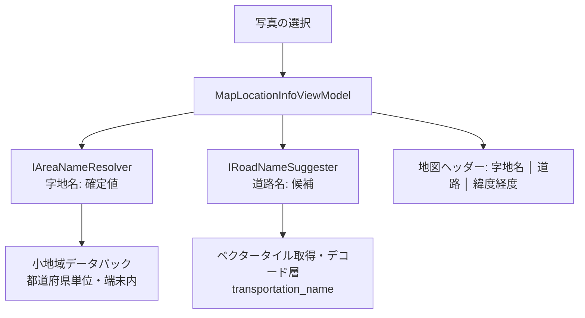

# 設計: 撮影位置の地理情報（字地名・道路名）と地図ヘッダー表示

- 状態: #292（ヘッダー表示）は実装済み。#294 以降は設計（実装未着手）
- 追跡 Issue: #292（ヘッダー表示）、#294（字地名）、#296（道路名）、#298（仮想ツリー）、#299（エクスポート）／親: #290
- 概要・依存関係: [README.md](README.md)

## 1. 目的

写真の EXIF GPS 座標から、次の 2 つを導出して地図ペインに表示する。

| 情報 | 判定 | 扱い |
|---|---|---|
| 字地名（都道府県・市区町村・町丁字） | 国勢調査 小地域ポリゴンへの点内包判定 | **確定値** |
| 最寄り道路名 | 道路中心線への最近傍探索 | **候補**（最寄りが撮影対象の道路とは限らない） |

写真ファイルには何も書き込まない。実体化（フォルダー分け・リネーム・台帳出力）はエクスポート時だけ行う。

## 2. 全体構成



- `MapLocationInfoViewModel` は `MapPaneViewModel` の子 ViewModel とし、選択の変化を受けて非同期に解決する。直前の解決はキャンセルする（`CancellationTokenSource` の管理は ViewModel）。
- 解決器（`IAreaNameResolver`・`IRoadNameSuggester`）は `PhotoGeoExplorer.Core` に置き、ファイル・通信へのアクセスはその内側の Service に閉じる。
- 3 項目は独立に解決して、揃ったものから表示する（緯度経度は即時、字地名は端末内、道路名は通信がありうる）。

## 3. 地図ヘッダー表示（#292）

### 3.1 レイアウト

現行のヘッダー（`MapPaneViewControl.xaml` の 1 行目）は、タイトル「地図」と右端の保存ボタンの間が空いている。ここに 1 行で表示する。

```text
┌──────────────────────────────────────────────────────────────────────────┐
│ 地図  上富良野町 宮町 │ 道路: 富良野平原広域農道 (+1) │ 43.468212, 142.482015   [💾] │
├──────────────────────────────────────────────────────────────────────────┤
│  [地図]                                                                  │
└──────────────────────────────────────────────────────────────────────────┘
```

| 要素 | 表記 | 操作 |
|---|---|---|
| 字地名 | `上富良野町 宮町`（既定は市区町村から。設定で都道府県名を含める） | ツールチップに完全な表記とキーコード |
| 道路名 | `道路: 富良野平原広域農道`、候補が複数なら `(+1)` | クリックで候補一覧（名称と距離）を表示 |
| 緯度経度 | `43.468212, 142.482015`（小数 6 桁） | クリックでクリップボードへコピー |

- 対象は**単一選択の写真**。複数選択・未選択・GPS なしのときは 3 項目とも表示しない。
- 未解決の項目は場所を空けず、解決できた項目だけを並べる。字地名のデータが未導入の地域では字地名を出さない（「不明」などの代替値は出さない）。

### 3.2 レスポンシブ

幅が足りないとき、右端の操作ボタンを保ったまま、次の順に省略する。

1. 緯度経度を非表示
2. 道路名を末尾省略（`…`）
3. 字地名を末尾省略

実装は View の責務（表示幅に応じた並べ方）として、優先度つきで子要素を収める専用パネル（`PriorityCollapsePanel`）を作る。ViewModel は 3 つの文字列と表示可否だけを公開し、幅の判定は持たない。

### 3.3 表示設定

`AppSettings` に次を追加する（既定値は括弧内）。

| 設定 | 既定 |
|---|---|
| `ShowMapHeaderAddress`（住所（国勢調査 字地名）を表示） | true |
| `ShowMapHeaderRoadName`（最寄り道路名（候補）を表示） | true |
| `ShowMapHeaderCoordinates`（緯度・経度を表示） | true |
| `MapHeaderIncludePrefecture`（住所表記に都道府県名を含める） | false |

設定画面の「地図」セクションと、地図ヘッダーの右クリックメニューの両方から切り替えられる。オフにした項目は解決処理も走らせない（道路名をオフにすればそのための通信は起きない）。

#292 は緯度経度の表示、設定、レスポンシブ、項目の枠組みまでを範囲とし、字地名と道路名は #294・#296 でこの枠に入れる。

## 4. 字地名の判定（#294）

### 4.1 データ

- 出典: e-Stat「国勢調査 小地域（町丁・字等別）境界データ」（Shapefile、世界測地系 緯度経度）。
- 主な属性: `KEY_CODE`、`PREF_NAME`、`CITY_NAME`、`S_NAME`（町丁・字等名）、`HCODE`（8101 = 町丁・字等、8154 = 水面調査区）。
- 実データでの確認（令和 2 年・鳥取県 `r2ka31`、2026-11-13）:
  - 構成は `.shp`・`.shx`・`.dbf`・`.prj` の 4 ファイルで、`.cpg` はない。属性の文字コードは Shift_JIS（`.dbf` ヘッダーの言語ドライバー ID で判定できる）
  - 座標系は `GCS_JGD_2011`（緯度経度）。ダウンロード時に「世界測地系緯度経度」を選んだ版。平面直角座標系の版は受け付けない
  - `KEY_CODE` は 9 桁または 11 桁（都道府県 2 桁 + 市区町村 3 桁 + 町丁字 4 桁、下位区分があればさらに 2 桁）。11 桁固定ではない
  - 同じ `KEY_CODE` のレコードが複数ある（飛び地など。この県で最大 4 件）。レコードごとに 1 つのポリゴンとして扱う
  - 2,503 レコードの読み込みは約 0.5 秒、メモリは約 12MB（開発機での 1 回の計測）
- 全国分は同梱できる大きさでなく、自前配信もしない。**都道府県単位の「地域データパック」を利用者が追加する**方式にする。

### 4.2 データパックの取り込み

- 第 1 段階: 利用者が e-Stat からダウンロードした ZIP を、設定画面の「地域データ」から取り込む。アプリは内容（必須属性、座標系、対象の都道府県、調査年）を検証し、`%LocalAppData%\PhotoGeoExplorer\AreaData\` に置く。
- 取り込み済みの都道府県・調査年・サイズを一覧表示し、削除できる。
- 取り込みの仕様（#294 の 3 つ目の PR のうち、取り込み・一覧・削除）:
  - 都道府県は、`KEY_CODE` の先頭 2 桁から判別する（全レコードが同じ都道府県であることを検証する。ファイル名の県コードは使わない）。調査年は、ファイル名（`r2ka31` の `r2` = 令和 2 年、`h27ka31` の `h27` = 平成 27 年）から判別する。判別できない ZIP は理由を示して拒否する
  - ZIP からは `.shp`・`.shx`・`.dbf`・`.prj` だけを、検証済みのファイル名で取り出す（ZIP 内のパスは使わない）。展開後の合計サイズの上限は 512MB（北海道で約 32MB）
  - 置く前に、座標系・必須属性・ポリゴン・単一の都道府県を実際に読んで検証する。検証に失敗した取り込みは、既存のデータを変えない
  - 同じ都道府県のデータがあれば置き換える（既存を退避してから移し、失敗したら戻す）
  - 保存先は `AreaData\<県コード>\`（取り込んだファイル名のまま）。一覧は、このフォルダーを見て作る（別の管理ファイルは持たない）
  - 壊れた・悪意のあるファイルへの備え: ライブラリは、ファイル内の点数やレコード数をもとに配列を確保するため、読み込む前に `ShapefileStructureGuard` で検査する（`.shp`: 各レコードの点数・部分数がレコード長に収まる、部分の開始位置が正しい、座標と外接矩形が経度 ±180・緯度 ±90 に収まる、ヘッダーのファイル長が実際と合う。`.dbf`: レコード数 × レコード長がファイルサイズに収まる）。ランダムにバイトを壊した約 9,600 件の実験では、検査なしだと 1 回の読み込みで 38GB を確保した。ライブラリが読む途中で投げる `NotSupportedException`・`InvalidDataException`・`ShapefileException`・`ArgumentException`・`FormatException` は、`AreaDataFormatException`（`IOException`）に包んで報告する。実データ 47 都道府県は、検査を通って取り込める（合計 16 秒）
  - 実データでの計測（開発機、1 回）: 北海道は取り込み（検証つき読み込み）約 1.9 秒、読み込み約 0.8 秒・約 79MB。東京は約 0.2 秒・約 27MB
- アプリ内ダウンロードは、e-Stat の利用規約と URL 仕様を確認したうえでの拡張とする（この設計の範囲外）。
- 形式は取り込んだ Shapefile をそのまま読む。読み込み時間が問題になった場合に限り、空間インデックスつきの形式（FlatGeobuf など）への変換を検討する。
- 出典表記（e-Stat／国勢調査の調査年）を、設定画面とヘルプに出す。
- ヘッダーへの接続（#294 の 3b）:
  - `MainWindow` の組み立てで、同梱の `PrefectureLocator`・共有の `AreaDataStore`・`AreaNameResolver` を作り、`MapPaneViewModel` → `MapLocationInfoViewModel` に渡す
  - 取り込み・置き換え・削除のあとは、`AreaDataStore.DataChanged`（`IAreaDataSource`）→ `AreaNameResolver.ResultsInvalidated`（`IAreaNameResolver`）の順に通知する。解決器は保持している都道府県のデータを破棄し、`MapLocationInfoViewModel` は表示中の写真の字地名を求め直す。通知は呼び出し元の同期コンテキスト（UI スレッド）で行う。内容が変わらなかった操作（何も消えなかった削除、失敗した取り込み）では通知しない
  - データの変更前に始まった読み込みは、完了しても保持しない（世代番号で判別する）。変更後の判定は、新しいデータを読み直す
  - 水面の小地域は住所として表示しない（`AreaName.IsWater`）
  - ツールチップ: 完全な表記（都道府県名つき）・小地域コード・調査年、最寄りの小地域へ補正した場合はその旨
### 4.3 判定

- 読み込み: `NetTopologySuite.IO.Esri` で読み、NetTopologySuite の `STRtree` に外接矩形を登録する。内包判定は `PreparedGeometry` を使う。R-Tree と Ray Casting は自作しない。
- 依存の追加: NetTopologySuite はアプリ本体（Mapsui.Nts 経由）では使っているが、**`PhotoGeoExplorer.Core` は参照していない**。解決器を Core に置くため、Core に `NetTopologySuite` と `NetTopologySuite.IO.Esri` の両方を追加する。NetTopologySuite の版は、アプリ本体で解決される版（Mapsui.Nts が要求する版）とそろえる。
- 対象の都道府県の絞り込み: **簡略化した都道府県ポリゴン**をアプリに同梱し（`PhotoGeoExplorer.Core/Resources/prefecture-polygons.tsv`、約 260KB。出典と加工内容は同じフォルダーの README）、座標から都道府県を引く。外接矩形だけでは、関東などで 3〜5 都県が候補になり、判定のたびに複数のデータを読むことになるため使わない。県境付近（簡略化の誤差の範囲）では隣接する都道府県も候補にし、小地域ポリゴンへの内包判定で確定する。
- 遅延読み込み: 都道府県単位で初回参照時に背景スレッドで読み、メモリ上に保持する（LRU、既定 4 都道府県）。上限は 1 回の判定の候補数より大きくし、同じ判定の中で読んだデータを追い出さない。件数とメモリ使用量は実データで計測して調整する。
- 境界線上・微小な隙間: どのポリゴンにも入らない場合、**30m 以内**の最近傍ポリゴンへ寄せる。距離はその地点での局所的なメートル換算で測る。寄せた結果であることは結果に持たせ、ツールチップに示す。
- 水面（`HCODE` が水面）の扱い: 水面ポリゴンに入った場合も、同じ 30m 以内に陸の町丁字があればそちらを優先する。
- 日本国外・データ未導入: 結果なし（表示しない）。

### 4.4 結果のモデル

```csharp
internal sealed record AreaName(
    string KeyCode,          // 9 桁または 11 桁
    string Prefecture,
    string City,
    string Town,             // 町丁・字等名
    bool SnappedToNearest,   // 最近傍へ寄せたか
    int CensusYear,
    bool IsWater = false);   // 水面調査区か（表示には使わない）
```

短縮表記（都道府県を省く、郡名の扱い）は表示側の関数に分け、パラメータ化テストで検証する。

## 5. 最寄り道路名のサジェスト（#296）

### 5.1 データ

- OpenFreeMap（OpenMapTiles スキーマ）の `transportation_name` レイヤーの線と、`name:ja`／`name`／`ref` を使う。
- 基盤地図情報の道路中心線は名称を持たないため使わない。道路台帳は公開データとして一律に入手できない。
- 取得・キャッシュ・デコードは、ベクター地図（[02](02-vector-renderer.md)）と同じ層を使う。**描画エンジンには依存しない**ので、レンダラーの採否と独立に実装できる。

### 5.2 判定

- 撮影地点を含むタイル（最大ズーム 14）と、地点がタイルの縁から探索半径以内にある場合は隣接タイルを対象にする。
- 各線分への最短距離を局所メートル換算で求め、**50m 以内**の道路を、名称（または路線番号）ごとに最短距離でまとめて近い順に最大 3 件返す。
- 候補にする道路は、`class` が `motorway`・`trunk`・`primary`・`secondary`・`tertiary`・`minor`・`service` のもの。歩行者用の経路（`path`。駅のホームなど）と農林道（`track`）は、「道路名」として出すと不自然なので候補にしない（実データでは、東京駅で最寄りが「JR東京駅;9番線」というホームの名称だった）。
- 名称は `name:ja` → `name` の順。名称も番号もない道路は候補にしない。複数の道路が重なる地物は、`;` で連結した名称・路線番号を持つので、分割して別の候補にする。路線番号は、名称と数が合うときだけ位置で対応させる。
- **種別（国道・都道府県道・市区町村道）は推定しない。** 国道は、名称が「国道53号」の形で入っているので、名称としてそのまま出る。名称がなく `ref` だけある道路は、「路線番号 203」と番号だけを出す（複数の路線が重なるときは「路線番号 53・373」）。
  - 実データ（2026-11-14。OpenFreeMap の z14、5 地点、名称つきの道路 48 本）で、`network` はすべて `road` で、`jp-national` などは 0 件だった。当初の「`network` が日本の経路網なら種別をつける」は、このデータでは発動しない。
  - `class` からの推定は外れる。地理院の最適化ベクトルタイルの種別（`vt_rdctg`）と突き合わせると、`trunk` → 国道（3/3）、`secondary` → 都道府県道（10/11）は合ったが、`primary` → 国道（実際は都道府県道。3/3）、`tertiary` → 都道府県道（実際は市区町村道等。11/11）は外れた。主要地方道を国道と表記するなどの誤りが、そのまま CSV やファイル名に出るため、推定は、地図上の盾の絵柄には使えても、文字として表示・出力する値には使わない。
  - 種別を確実に出す案として、地理院のタイルの種別を、位置で突き合わせる方法は、技術的に可能だった（地理院の道路中心線は名称・路線番号を持たないので、OpenFreeMap の線と 12 m 以内で対応させる。48 本すべてで対応した）。2 つ目の配信元への通信と突き合わせの処理が要るため、この Issue の範囲外とする。
- 候補が 0 件なら表示しない。実データでは、地方の地点で 50 m 以内に名称つきの道路がないことが多かった（鳥取県庁付近は最寄り 70 m、富良野は 159 m）。

### 5.3 結果のモデルと表示

```csharp
internal sealed record RoadNameCandidate(string? Name, string? Ref, double DistanceMeters);
```

- `Name` はデータにある名称。名称がなく路線番号だけの道路は null。`Ref` は路線番号で、複数は「・」でつなぐ（種別は含まない）。少なくとも一方がある。名称のない道路の表記（「路線番号 203」）は、言語に合わせて表示側が整える（`LocationTextFormatter`）。

- ヘッダーには第 1 候補と残り件数（`(+N)`）を出す。クリックで候補一覧を出す。
- 「候補」であることを UI 上で崩さない（ラベルは「道路:」とし、ツールチップに「最寄りの道路（候補）」と距離を示す）。
- 候補からの手動確定と、その保存は #299（エクスポート）の範囲とする。確定値は写真ファイルではなく、アプリのローカルな注釈ストアに持つ。

### 5.4 通信とプライバシー

- 道路名の解決は、撮影地点のタイル座標（z14、約 2km 四方）を OpenFreeMap へ送る。地図表示と同程度の粒度だが、背景に OSM ラスタ／Esri を使っている利用者にとっては新しい送信先になるため、プライバシーポリシーとヘルプに明記する。
- 設定で道路名表示をオフにすれば通信しない。オフラインではキャッシュにあるタイルだけで解決し、なければ表示しない。
- 取得は配信元の並列数・間隔の制限に従う。選択を素早く切り替えたときは、直前の解決をキャンセルする。

### 5.5 実装の構成と決定（#296）

- 決定事項（ユーザー合意 2026-11-14）: 歩行者用の経路（`path`）は候補に含めない。距離のしきい値は 50 m のまま。種別は推定せず、国道は名称で確定し、他は路線番号とする。
- 判定は `RoadNameSuggester`（Core）。タイルは `IRoadTileSource` で受け取る。`VectorRoadTileSource` が、タイルの取得・キャッシュ（NuGet パッケージ `PhotoMapStudio.Tiles`。photo-map-studio #109）のバイト列を、タイルへ読み出す。取得の失敗は `HttpRequestException`、タイルとして読めない内容は `IOException` で報告する（`IRoadNameSuggester` の契約）。
- 実装の分割: 1 つ目の PR は Core（判定・モデル・整形・文字列・テスト）。2 つ目の PR は UI（配線、候補の一覧、プライバシーポリシーとヘルプ）。

## 6. 仮想ツリー（GroupBy）ビュー（#298）

- 物理フォルダーを変えずに、現在のフォルダー内の写真を「市区町村 > 町丁・字」で束ねたツリーを表示する。ノードを選ぶと、該当する写真を一覧と地図で強調する。
- フォルダー内の全写真の字地名が要るため、解決結果を写真ごとにキャッシュする（座標が鍵）。大量の写真では背景で順に解決し、進捗を出す。
- 配置（ファイルペイン内の切り替えか、別ペインか）は、この Issue の着手時に UI 案を出して決める。
- 配置・対象の決定（ユーザー合意済み）:
  - 配置: **新しいペイン種別「字地名」**を、ファイル・プレビュー・地図に加える。設定のレイアウトで各領域に割り当てる（同時に出せるのは 3 つまで。既定のレイアウトは変えない）。ファイルペインの ViewModel・View には手を入れない
  - ノードを選ぶと、該当する写真をファイル一覧で選択する（既存の `WorkspaceState.RequestPhotoSelection`）。地図とプレビューは、既存の「選択への追従」でそのまま更新される
  - 対象は現在のフォルダーのみ（サブフォルダーは含めない）
- 実装の分割: 1 つ目の PR は Core のロジック（`AreaTreeBuilder`・`PhotoAreaClassifier`）、2 つ目の PR はペインの UI と、レイアウト・設定への組み込み。
- 結果のモデル: `AreaTreeNode`（種類・キー・表示名・子孫を含む写真のパス・子）。特別なノード（水面・地域データなし・位置情報なし）の表示名は、表示側が持つ。
- ペインの実装（2 つ目の PR）:
  - `PaneViewType.Places` を足し、`PaneLayoutHostService`・設定のレイアウト（選択肢と入れ替え）・設定の正規化が 4 つのビューに対応する。ビューの入れ替えは、割り当てが 3 つに限られるため「選んだビューが別の領域に出ていれば入れ替え、出ていなければ、その領域のビューだけが外れる」になる
  - 現在のフォルダーの写真は `WorkspaceState.PhotoItems` で受け取る。`FileBrowserPaneViewModel` が、フォルダーの読み込みのたびに公開する（並べ替えでは公開しない）
  - `PlacesPaneViewModel`（`PaneViewModelBase`）が、`PhotoAreaClassifier` を背景で実行して、`AreaTreeBuilder` のツリーを `PlacesNodeViewModel` で見せる。位置情報を全写真から読むため、ペインが表示されている間（`IsActive`）だけ判定する。`MainWindowLayoutCoordinator` が、いずれかの領域が字地名で、プレビューが最大化されていないときに `IsActive` を立てる
  - 進捗は、背景の判定が集めた結果を、UI スレッドで一度にまとめてツリーへ反映する（一定の枚数ごと）。完了時は集めた全結果で作り直す。判定の世代で、古い結果を受け付けない。展開状態はキーで保ち、作り直しても開いたままにする
  - ノードの選択は View（`ItemInvoked`）から VM へ委譲し、`WorkspaceState.RequestPhotoSelection` で一覧の選択にする
  - 判定は、地域データの取り込み・削除（`IAreaNameResolver.ResultsInvalidated`）で自動でやり直す。字地名を 1 件も判定できなかったときは、地域データの取り込みを案内する## 7. エクスポート（#299）

## 7. エクスポート（#299）

| 機能 | 内容 |
|---|---|
| 台帳用メタデータ出力 | ファイル名、字地名（都道府県・市区町村・町丁字・キーコード）、道路名、緯度経度、撮影日時を CSV（UTF-8 BOM つき）で出力 |
| フォルダー分けコピー | 選択した写真を「字地名別フォルダー」へ**コピー**する（元のファイルは動かさない） |
| リネーム出力 | `{日付}_{字名}_{道路名}_{連番}.jpg` の形式でコピー出力する |

- 道路名の列は、利用者が確定した値を優先し、未確定なら第 1 候補を「候補」と分かる形で出す。確定値を保存する注釈ストア（`%LocalAppData%` 配下。写真のパス・サイズ・撮影日時で対応づける）をこの Issue で設計する。
- ファイル名の生成（使用できない文字の置換、長さ制限、連番、重複回避）とコピーの実処理は Service、進捗・キャンセル・件数集計は ViewModel、ダイアログは View に置く（既存の移動操作と同じ分担）。
- Excel 形式は、CSV で足りないことが分かった時点で検討する。
- 決定事項（ユーザー合意済み）と実装の分割:
  - 起動場所: メニューバーの「ファイル > エクスポート」のサブメニューと、ファイル一覧の右クリックメニュー。対象は、ファイル一覧で選択している写真（字地名のペインのノードを選ぶと、その写真が選択される）
  - 字地名別フォルダーへのコピー: 出力先の下に「市区町村 / 町丁・字 / 元のファイル名」。同名の市区町村が複数の都道府県にまたがるときだけ「中央区（東京都）」と都道府県名を添える。字地名がない写真は、水面・地域データなし・位置情報なしの専用フォルダーへ入れる
  - 道路名（#296）は、まだ列にもファイル名のトークンにも出さない。CSV は「ファイル名・都道府県・市区町村・町丁字・キーコード・緯度・経度・撮影日時・判定」、リネームは `{日付}_{字名}_{連番}`。#296 の後に、CSV は末尾へ列を足し（取り込み側の列の位置を変えない）、リネームは `{日付}_{字名}_{道路名}_{連番}` にする
  - 1 つ目の PR は Core の純粋なロジック（`Services/Export/`）: `ExportNameSanitizer`（使えない文字・予約名・長さ・サロゲートペア）、`ExportPlanBuilder`（フォルダーコピーとリネームの計画。連番は同じ日付・字名の中で撮影日時順に 001 から。同名の重なりは「名前 (2)」）、`GeoCsvWriter`（UTF-8 BOM・CRLF・引用符、数式として解釈されうる先頭の `=`・`+`・`-`・`@` は `'` で無効にする。緯度経度は数値の列なので対象外）。2 つ目の PR は、実処理（コピー・CSV の書き出し・競合）と ViewModel・UI
  - 2 つ目の PR（実処理と UI）: `PhotoGeoRecordLoader`（Core。`IExifMetadataService` のメタデータ＋`IAreaNameResolver` で、撮影日時・撮影位置・字地名を並列に読む。読めない写真は位置情報なし）、`GeoExportService`（コピー: 1 件の失敗で止めない・出力先の外へ出る相対パスは受け付けない・元のファイルへのコピーは何もしない・1 つのファイルのコピーは途中で止めない・競合は上書き／スキップ／中止（すべて上書き／すべてスキップ）、CSV の書き出し）、`GeoExportViewModel`（ループ・進捗・キャンセル・件数の集計。`WorkspaceState.SelectedPhotos` が対象）、`GeoExportUi`（ピッカー・競合ダイアログ・通知。既存の `FileBrowserDialogs` を共用）。進捗は、ステータスバー（進捗の文言と「中止」）に出す。メニューは、MainWindow の「ファイル > エクスポート」と、`FileBrowserMenuBuilder` の右クリックメニュー（`GeoExportViewModel` のコマンドを渡す）
  - 確認済み（実機）: 60 枚（鳥取県内・岩美町・海上・東京・GPS なし）で、CSV（BOM つき UTF-8・60 行・判定の内訳が一致）、字地名別のフォルダーへのコピー（鳥取市 22 町丁・岩美町 6 町丁・地域データなし・位置情報なし。元の 60 枚は残る）、同じ出力先への再コピーでの競合ダイアログ（すべてスキップ → 0 枚コピー・60 枚スキップ）、リネームしてコピー（`20240102_字名_001.jpg`・重複なし）
## 8. テスト方針

- 字地名: 小さな合成ポリゴンのフィクスチャで、内包・境界上・隙間（30m 以内／超）・水面・データなしをパラメータ化テストで検証する。実データには依存しない。
- 道路名: 合成したデコード済みタイルで、距離順・名称のまとめ・`ref` の整形・タイルの縁・半径外を検証する。タイル取得はモックにする。
- `MapLocationInfoViewModel`: 選択の切り替えでのキャンセル、設定オフ時に解決器を呼ばないこと、`PropertyChanged` が UI スレッドで発火すること。
- 表記の整形（短縮・都道府県の有無・座標の桁）: パラメータ化テスト。
- 手動: ヘッダーのレスポンシブ（幅を縮めたときの省略順）、コピー、候補一覧。

## 9. 実装時に確認すること

- e-Stat 境界データの利用規約と出典表記（属性名・座標系・ファイル構成は §4.1 のとおり確認済み）
- 小地域 Shapefile の読み込み時間とメモリ使用量（鳥取県は §4.1 のとおり。北海道など大きい都道府県では未計測）
- `transportation_name` の z14 での道路形状の簡略化が、50m のしきい値に対して十分か（実データで確認し、しきい値を調整する）
