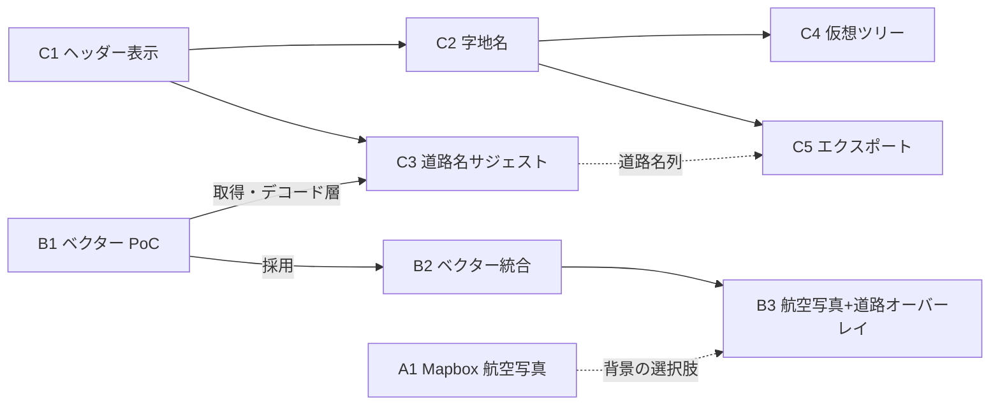

# 地図機能拡充 設計概要・ロードマップ

- 状態: 設計（実装未着手）
- 作成日: 2026-11-12
- 対象バージョン: v1.9.3 以降
- 追跡 Issue: #290（親）

## 1. 目的

PhotoGeoExplorer の地図ペイン（Map Pane）を、次の 3 テーマで拡充する。

| テーマ | 内容 | 設計書 |
|---|---|---|
| A. Mapbox 航空写真 | ユーザー自身のアクセストークン（BYO Token）で Mapbox Satellite を背景に使えるようにする | [01-mapbox-satellite.md](01-mapbox-satellite.md) |
| B. ベクター地図レンダラー | PhotoMapStudio の SkiaSharp ベクター描画エンジンを背景地図として統合し、生活道路名の視認性を上げる | [02-vector-renderer.md](02-vector-renderer.md) |
| C. 撮影位置の地理情報 | 国勢調査 小地域から字地名（確定値）、道路中心線から最寄り道路名（候補）を導出し、地図ヘッダーに表示する | [03-location-info.md](03-location-info.md) |

元になった検討は、ハンドオフ `2026-10-27_PhotoGeoExplorer_map-enhancement-ideas.md` と `map_info.md` である。本ディレクトリの設計書は、その方針を現行コード（`Panes/Map`・`Services`・`PhotoGeoExplorer.Core`）に当てはめ、未決事項に結論を出したものである。

## 2. 全体方針

1. **非破壊**: 写真ファイルの移動・リネーム・EXIF 書き換えを伴わない。導出した地理情報はビューワー上の参照情報として扱い、実体化はエクスポート時だけ行う。
2. **確定値と候補を区別する**: 面（ポリゴン）への内包判定で決まる字地名は確定値、線（道路）への最近傍探索で決まる道路名は候補として、UI・データモデルの両方で区別する。
3. **背景地図は置換ではなく選択肢の追加**: OSM ラスタ・Esri 航空写真は残し、Mapbox 航空写真と自前ベクター地図を選択肢として足す。
4. **ベクター地図は PoC の採否判定を通ってから製品へ入れる**: 「利用者が変化にほぼ気づかない」ことを成功条件とし、基準を満たさなければ採用しない。
5. **開発者の API キー・自前サーバーを持たない**: Mapbox は BYO Token、ベクタータイルは OpenFreeMap／国土地理院の公開配信、小地域境界は利用者が e-Stat から取得したデータを使う。
6. **既存ガードレールの遵守**: `MainWindow` には処理を足さない。ロジックは `Panes/Map/*ViewModel`・`Services`・`PhotoGeoExplorer.Core` に置き、ファイルシステム・通信に触れる処理は Service に置く。

## 3. Issue 構成と依存関係

| Issue | 内容 | 依存 | 優先 |
|---|---|---|---|
| #290 | 地図機能拡充（親） | — | — |
| #291 | Mapbox 航空写真（BYO Token） | なし | 高 |
| #292 | 地図ヘッダーへの撮影位置情報表示（緯度経度・表示設定・レスポンシブ） | なし | 高 |
| #294 | 国勢調査 小地域による字地名の判定と表示 | #292 | 高 |
| #293 | ベクター地図レンダラー PoC（P0〜P3）と採否判定 | なし | 中 |
| #295 | ベクター地図レンダラーの製品統合 | #293 が「採用」 | 中 |
| #296 | 最寄り道路名のサジェスト | #292、ベクタータイル取得・デコード層（#293 の成果） | 中 |
| #297 | 航空写真＋道路ベクターの透過オーバーレイ | #295 | 低 |
| #298 | 字地名による仮想ツリー（GroupBy）ビュー | #294 | 低 |
| #299 | 地理情報つきエクスポート（CSV・フォルダー分けコピー・リネーム出力） | #294（道路名は #296） | 低 |

推奨の着手順は **A1 → C1 → C2 → B1 →（採否判定）→ B2 / C3 → B3 / C4 / C5** である。A1・C1・C2 は互いに独立で、ベクター PoC の結果を待たずに出荷できる。C3 はレンダラーの採否に関係なく、タイルの取得・デコード層だけに依存する。

## 4. ハンドオフの未決事項への結論

| 未決事項 | 結論 | 根拠（詳細は各設計書） |
|---|---|---|
| Mapbox のエンドポイント | Raster Tiles API（`/v4/mapbox.satellite/...`） | 航空写真だけが欲しく、スタイル合成（Static Tiles API）は不要。JPEG を選べて転送量が小さい |
| Mapbox トークンの保存方式 | Windows 資格情報ロッカー（`PasswordVault`）。`settings.json` には書かない | 設定ファイルは不具合報告で共有されうる。追加の NuGet 依存なしで OS の保護を使える |
| Mapbox タイルの永続キャッシュ | **既定では行わない**（メモリキャッシュのみ）。ハンドオフの `FileCache` 案から変更 | Mapbox の利用規約はタイルの保存を制限している。実装時に現行規約を確認し、許される範囲が明確な場合だけ有効化する |
| Mapsui への表示範囲画像の注入方式 | 専用レイヤー＋カスタムスタイルレンダラーで `SKImage` を地理範囲へ描く。PoC P1 で `RasterFeature` 案と比較して確定 | PNG エンコードを挟まず、PNG 保存（`RenderToBitmapStream`）にも同じ経路で乗る |
| PhotoMapStudio の実装の共有方法 | 製品統合時は NuGet パッケージ化（PoC 中はスパイクブランチへの一時的な取り込み） | 2 リポジトリでのコピー保守は技術負債になる。Renovate で更新を追える |
| 小地域データの入手方法 | 第 1 段階は利用者が e-Stat から取得した ZIP の取り込み。アプリ内ダウンロードは規約確認後の拡張 | 全国分は同梱できる大きさでなく、自前配信もしない方針のため |
| 空間インデックス・内包判定の実装 | NetTopologySuite（既存依存）の `STRtree` と `PreparedGeometry` | R-Tree・Ray Casting を自作しない |
| 道路名の取得元 | OpenFreeMap（OpenMapTiles スキーマ）の `transportation_name` レイヤー | 基盤地図情報の道路中心線は名称を持たない。地図表示と同じ取得・キャッシュを共用できる |

## 5. 横断的な注意点

- **SkiaSharp のバージョン整合**: PhotoMapStudio は SkiaSharp 4.x、PhotoGeoExplorer は Mapsui 5.1.0 経由で SkiaSharp を使う。統合時に同一プロセスで版が 1 つに統一されるため、Mapsui が解決後の版で動くことを PoC P1 の最初に確認する。合わない場合もダウングレードで解決せず、Mapsui 側の追従を待つか PoC を保留する。
- **プライバシーポリシー**: Mapbox（A1）と OpenFreeMap／国土地理院（B・C3）は、表示範囲のタイル座標を新しい外部サービスへ送る。該当 Issue の PR で `docs/privacy-policy` とヘルプを更新する。字地名の判定（C2）は端末内で完結する。
- **帰属表示**: 背景ごとの帰属表示（Mapbox のワードマークと文言、OSM、国土地理院、e-Stat の出典）を、画面と PNG 保存の両方に出す。
- **ログ**: アクセストークンと、トークンを含む URL をログに出さない（A1）。
- **ローカライズ**: 追加する文言は既存の `x:Uid`／`LocalizationService` の仕組みで日本語・英語を用意する。
